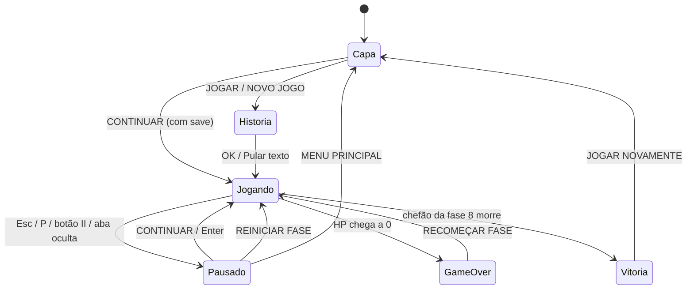

# HamsterVania: O Cavaleiro Valente — Documentação Técnica

> Jogo de plataforma 2D estilo *Metroidvania/boss rush* em **um único arquivo HTML** (HTML + CSS + JavaScript puro, Canvas 2D e Web Audio). Sem frameworks, sem build, sem dependências obrigatórias.

- **Arquivo:** `HamsterVania.html` (~2.500 linhas)
- **Idioma da interface:** Português (pt-BR)
- **Plataformas:** PC (teclado/mouse) e celular/tablet (touch), em retrato e paisagem
- **Resolução lógica do jogo:** 800 × 450 px (16:9), escalada por CSS para qualquer tela

---

## Sumário

1. [Visão geral do jogo](#1-visão-geral-do-jogo)
2. [Como executar e depurar](#2-como-executar-e-depurar)
3. [Estrutura do arquivo](#3-estrutura-do-arquivo)
4. [Interface (HTML)](#4-interface-html)
5. [Estilos e layout responsivo (CSS)](#5-estilos-e-layout-responsivo-css)
6. [Estado global do jogo](#6-estado-global-do-jogo)
7. [Loop principal](#7-loop-principal)
8. [Controles e entrada](#8-controles-e-entrada)
9. [Jogador](#9-jogador)
10. [Fases, mundo e câmera](#10-fases-mundo-e-câmera)
11. [Inimigos comuns](#11-inimigos-comuns)
12. [Chefões e sala trancada](#12-chefões-e-sala-trancada)
13. [Combate, dano e projéteis](#13-combate-dano-e-projéteis)
14. [Renderização](#14-renderização)
15. [Áudio](#15-áudio)
16. [Fluxo de telas e menus](#16-fluxo-de-telas-e-menus)
17. [Sistema de save](#17-sistema-de-save)
18. [Menu de pause](#18-menu-de-pause)
19. [Referência de funções](#19-referência-de-funções)
20. [Tabela de balanceamento](#20-tabela-de-balanceamento)
21. [Como estender o jogo](#21-como-estender-o-jogo)
22. [Comportamentos conhecidos e limitações](#22-comportamentos-conhecidos-e-limitações)
23. [Histórico de modificações](#23-histórico-de-modificações)

---

## 1. Visão geral do jogo

**Enredo:** o Conde Drácula roubou o estoque de sementes douradas de **Jujuba**, uma hamster cavaleira. Ela atravessa **8 regiões**, cada uma terminando em um chefão, para recuperar a comida.

**Estrutura de cada fase:**

```
x = 0                                    x = 2000        x = 2800
|-------- corredor com plataformas -------|--- sala do chefão ---|
   5 inimigos comuns patrulham                 portão fecha ao entrar
   (fase 3 tem um NPC em vez deles)            chefão com padrões de ataque
```

**Habilidades da heroína:**

| Ação | Descrição |
|---|---|
| Mover / Pular | Corrida horizontal e pulo (só no chão) |
| Atacar | Golpe de espada de curto alcance |
| Dash | Investida curta e **invulnerável**, consome **estamina** |
| Magia | Projétil que consome **MP** |

**Condições:**

- **Vitória:** derrotar o chefão da fase 8.
- **Derrota:** HP chega a 0 → *Game Over* → recomeça a fase atual.

---

## 2. Como executar e depurar

### Executar

Basta abrir `HamsterVania.html` em um navegador moderno (Chrome, Edge, Firefox, Safari). Não precisa de servidor.

> A fonte **Press Start 2P** é carregada do Google Fonts. Sem internet o jogo funciona normalmente com fonte monoespaçada de reserva.

### Requisitos de navegador

- Canvas 2D, Web Audio API, Pointer Events
- **Container queries** (`cqw`) e `clamp()` — Chrome/Edge 105+, Safari 16+, Firefox 110+
- `localStorage` (opcional; sem ele o jogo roda, mas não salva)

### Depuração pelo console

Como o script é clássico (não é módulo), as variáveis de topo ficam acessíveis no console do navegador:

```js
player.hp = 100;                    // restaurar vida
player.x = BOSS_ARENA_X + 100;      // teleportar para a sala do chefão
damageBoss(99999);                  // matar o chefão (avança de fase e salva)
currentStage                        // fase atual
localStorage.getItem('hamstervania_save_v1')   // ver o save
localStorage.clear();               // apagar save e preferência de música
```

---

## 3. Estrutura do arquivo

O arquivo tem três blocos:

| Bloco | Conteúdo |
|---|---|
| `<head>` + `<style>` | Metadados, fonte, **todo o CSS** (incluindo o layout responsivo) |
| `<body>` | Estrutura da interface: palco 16:9, telas sobrepostas, HUD, controles touch, legenda de teclado |
| `<script>` | **Toda a lógica** do jogo, na ordem listada abaixo |

**Ordem do JavaScript** (de cima para baixo):

1. Canvas, contextos e áudio (`initAudio`, `playSound`, música de fundo)
2. Estado global, constantes, objeto `player`, nomes dos chefões e temas das fases
3. Capa animada (`drawCoverArt` e auxiliares)
4. Início de jogo (`startLoreIntro`, `beginGameplay`, `initStage`)
5. Entrada por teclado
6. Lógica: `update`, inimigos, espada, chefão, dano, partículas
7. Renderização: `draw`, jogador, inimigos, NPC, chefões
8. Fim de jogo: `gameOver`, `restart`, `restartGame`
9. **Bloco de responsividade e controles:** loop de passo fixo, layout, touch, tela cheia, Enter
10. **Sistema de save** e *toasts*
11. **Menu de pause** e atalhos Esc/P

> Por ser um script único e global, funções chamadas por `onclick="..."` no HTML (como `startLoreIntro()`, `resumeGame()`) precisam continuar globais.

---

## 4. Interface (HTML)

Todo o jogo vive dentro de `#app`, que ocupa a janela inteira (`position: fixed; inset: 0`).

```
#app
├── #stageWrap                  ← container 16:9, tamanho definido por JS (fitLayout)
│   └── #stage                  ← moldura laranja, recorta o conteúdo
│       ├── #startScreen        ← capa + botões (z-index 20)
│       │   ├── #coverCanvas
│       │   ├── título e subtítulo
│       │   └── #continueBtn, #startBtn, #fsBtn, #rotateHint
│       ├── #loreScreen         ← história (z-index 25)
│       ├── #msgScreen          ← Game Over / Vitória (z-index 30)
│       ├── #pauseScreen        ← menu de pause (z-index 35)
│       ├── #hud                ← HP, MP, ST, fase, chefão (z-index 10)
│       ├── #pauseBtn           ← botão "II" (z-index 11)
│       ├── #toast              ← avisos temporários (z-index 12)
│       └── #gameCanvas         ← o jogo (800×450)
├── #kbHints                    ← legenda de teclas (só PC)
└── #mobileControls             ← controles touch
    ├── #dpad    (#btnLeft, #btnRight)
    └── #actions (#btnMagic, #btnDash, #btnJump, #btnAttack)
```

### IDs usados pelo JavaScript

| ID | Função |
|---|---|
| `gameCanvas` / `coverCanvas` | Canvas do jogo e da capa (800×450 cada) |
| `startScreen`, `loreScreen`, `msgScreen`, `pauseScreen` | Telas sobrepostas (alternam a classe `hidden`) |
| `startBtn` | "JOGAR" (sem save) ou "NOVO JOGO" (com save) |
| `continueBtn` | "CONTINUAR - FASE N"; fica oculto sem save |
| `fsBtn` | "TELA CHEIA"; só aparece se o navegador suporta |
| `rotateHint` | Dica "gire o celular"; só em retrato no touch (CSS) |
| `msgTitle`, `msgDesc`, `restartBtn` | Conteúdo da tela de Game Over/Vitória |
| `hud`, `hpBar`, `mpBar`, `stBar` | HUD do jogador (vida, mana, estamina) |
| `stageNum`, `stageTitleHud` | Número e nome da fase |
| `bossHud`, `bossName`, `bossHpBar` | HUD do chefão (opacidade 0 até entrar na arena) |
| `pauseBtn`, `musicBtn`, `resumeBtn` | Controles do menu de pause |
| `toast` | Aviso curto no centro-superior |
| `mobileControls`, `dpad`, `actions`, `btn*` | Controles touch |
| `kbHints` | Legenda de teclado |

### Classes utilitárias

- `.hidden` → `display: none !important`. É o mecanismo padrão para mostrar/esconder telas.
- `.opacity-0` → `opacity: 0 !important`. Usado no HUD do chefão.
- `.pixel-btn` → botão com visual pixel art (borda laranja e sombras internas).
- `.overlay` → camada que cobre o palco inteiro (flex vertical centralizado).

---

## 5. Estilos e layout responsivo (CSS)

### 5.1 Princípio

O jogo sempre é desenhado em **800×450**. O **tamanho na tela** é decidido por JavaScript (`fitLayout`), e **toda a interface sobreposta** (menus, HUD) escala junto, usando unidades relativas ao palco.

### 5.2 Unidades relativas ao palco

- `#stageWrap` tem `container-type: size`; seu tamanho (px) é definido por `fitLayout()`.
- `#stage` define `font-size: clamp(8px, 2cqw, 36px)`. Assim, `1em` dentro do palco equivale a ~2% da largura do jogo (16px quando o palco tem 800px).
- Quase todo tamanho da interface usa `em` (ou `cqw` nas barras do HUD) e portanto acompanha o tamanho do palco.
- Textos pequenos usam `max(Npx, ...)` para nunca ficarem ilegíveis em telas pequenas.

| Elemento | Largura da barra (HUD) |
|---|---|
| HP (`.bar-hp`) | `20cqw` |
| MP (`.bar-mp`) | `14cqw` |
| Estamina (`.bar-st`) | `17cqw` |
| Chefão (`.bar-boss`) | `18cqw` |

### 5.3 Classes no `<body>`

O JavaScript alterna classes no `body`, e o CSS reage a elas:

| Classe | Quando | Efeito |
|---|---|---|
| `touch` | Dispositivo de toque detectado | Mostra controles touch, esconde `#kbHints`, bordas finas |
| `portrait` / `landscape` | `innerHeight > innerWidth` ou não | Escolhe o layout dos controles |
| `playing` | Durante a partida (`setControlsVisible(true)`) | Mostra `#mobileControls` e `#pauseBtn` |
| `paused` | Jogo pausado | Esmaece e desativa os controles touch |

### 5.4 Layouts por situação

| Situação | Palco | Controles |
|---|---|---|
| **PC** | Ajustado à janela (máx. 1920px), centralizado; legenda de teclado abaixo | Ocultos |
| **Celular em paisagem** | Maior possível (16:9) e centralizado | Sobrepostos, nos cantos da **tela**, 80% opacos; D-pad à esquerda, ações em **uma linha** à direita |
| **Celular em retrato** | Largura total, centralizado verticalmente acima dos controles | Embaixo, grandes: D-pad à esquerda, ações em **grade 2×2** à direita |

Tamanho dos botões (`--b`): retrato `clamp(54px, 17vw, 84px)`; paisagem `clamp(46px, 14vh, 70px)`. O texto dos botões é `max(7px, calc(var(--b) * .13))` para as 6 letras de "ATACAR" caberem na fonte pixel.

### 5.5 Botões de controle (`.ctl-btn`)

São `div`s com `pointer-events: none`: **quem recebe o toque é o grupo** (`#dpad` / `#actions`, com `touch-action: none`). Isso permite arrastar o dedo entre botões (ver [seção 8](#8-controles-e-entrada)). A classe `.active` mostra o botão pressionado; `.nostam` esmaece o DASH sem estamina.

### 5.6 Outros detalhes

- `html, body { overflow: hidden; overscroll-behavior: none }` — sem rolagem nem *pull-to-refresh*.
- `user-select: none`, `-webkit-touch-callout: none` e `-webkit-tap-highlight-color: transparent` evitam seleção e *flash* ao tocar.
- `canvas { image-rendering: pixelated }` mantém os pixels nítidos ao ampliar.
- Safe areas (`env(safe-area-inset-*)`) são respeitadas nos controles (notch/barra inferior).
- `viewport-fit=cover` e `user-scalable=no` no `<meta viewport>`.

---

## 6. Estado global do jogo

### Variáveis de fluxo

| Variável | Tipo | Descrição |
|---|---|---|
| `gameRunning` | bool | Há partida em andamento (inclui pausado) |
| `paused` | bool | Jogo pausado |
| `currentStage` | int 1–8 | Fase atual |
| `TOTAL_STAGES` | const = 8 | Número de fases |
| `animFrameCounter` | int | Contador de frames lógicos (animações de fundo) |
| `musicOn` | bool | Música ligada (persistida em `localStorage`) |

### Mundo

| Variável | Valor | Descrição |
|---|---|---|
| `GRAVITY` | `0.5` | Aceleração vertical por passo |
| `STAGE_WIDTH` | `2800` | Largura total da fase (px) |
| `BOSS_ARENA_X` | `2000` | Onde começa a sala do chefão |
| `BOSS_WALL_X` | `2014` | Posição da "parede" do portão |
| `cameraX` | número | Deslocamento horizontal da câmera |
| `bossLocked` | bool | Sala trancada |
| `gateAnim` | 0–1 | Animação do portão (0 aberto, 1 fechado) |
| `platforms` | array | Plataformas da fase: `{x, y, w, h}` |

### Entidades

| Variável | Descrição |
|---|---|
| `player` | Objeto único da heroína (ver [seção 9](#9-jogador)) |
| `boss` | Chefão da fase atual |
| `stageEnemies` | Inimigos comuns vivos |
| `playerProjectiles` | Magias da heroína |
| `enemyProjectiles` | Projéteis de inimigos e chefão |
| `particles` | Partículas visuais |
| `npcObj` | NPC da fase 3 (ou `null`) |
| `hasOneHitSword` / `npcInteracted` | Estado da espada especial (fase 3) |

### Entrada

```js
const keys = { left, right, jump, attack, dash, magic };   // todos booleanos
```

Teclado e touch escrevem nesse mesmo objeto; `update()` só lê `keys`.

---

## 7. Loop principal

O loop usa **passo fixo de 60 atualizações por segundo**, independente da taxa de atualização da tela. Isso mantém a velocidade igual em monitores de 60, 90, 120 ou 144 Hz.

```js
const STEP_MS = 1000 / 60;

function mainLoop(ts) {
  requestAnimationFrame(mainLoop);
  acc += Math.min(ts - lastTs, 100);   // limita saltos de tempo (aba em segundo plano)
  lastTs = ts;
  if (paused) acc = 0;                 // pausado: física não avança
  let steps = 0;
  while (acc >= STEP_MS && steps < 4) { update(); acc -= STEP_MS; steps++; }
  if (steps === 4) acc = 0;            // evita "espiral da morte"
  draw();                              // desenha uma vez por frame de tela
}
```

- `startLoop()` inicia o loop **uma única vez** (`loopStarted`). Chamar duas vezes não cria loops duplicados.
- `draw()` roda sempre (mesmo pausado ou em Game Over), então a cena continua visível.
- Toda a física está em **unidades por passo** (não por segundo). Ex.: `speed: 3.8` = 3,8 px por passo ≈ 228 px/s.

### Ordem dentro de `update()`

1. Contador de frames; recarga de MP
2. Se não está em dash: movimento, pulo, ataque, magia, início do dash
3. Contadores de recarga (ataque, magia, dash, estamina, invulnerabilidade pós-dano)
4. Término do dash
5. Gravidade e integração da posição; limites do mundo
6. Câmera
7. **Trava da sala do chefão** (portão e parede)
8. Colisão com plataformas
9. `updateStageEnemies()`
10. Projéteis da heroína (colisão com inimigos e chefão)
11. `updateBoss()` (se a heroína está na arena)
12. Projéteis inimigos (movimento, homing, colisão com a heroína)
13. Partículas
14. Atualização das barras do HUD

---

## 8. Controles e entrada

### 8.1 Teclado

| Ação | Teclas |
|---|---|
| Mover | `A` / `D` ou `←` / `→` |
| Pular | `W`, `Espaço` ou `↑` |
| Atacar | `J` ou `Z` |
| Dash | `K` ou `X` |
| Magia | `L` ou `C` |
| Pausar / retomar | `Esc` ou `P` |
| Começar / avançar / recomeçar | `Enter` |

- `keydown` só vale com `gameRunning && !paused`; `keyup` sempre libera a tecla.
- Setas e espaço chamam `preventDefault()` para a página não rolar.
- `blur` da janela e `visibilitychange` chamam `resetKeys()` para não deixar teclas "presas".

### 8.2 Atalho Enter

O Enter age conforme a tela visível (nesta ordem de prioridade):

| Tela visível | Ação |
|---|---|
| Pause | `resumeGame()` |
| Game Over / Vitória | `restart()` |
| História | `beginGameplay()` |
| Capa | `continueGame()` se há save; senão `startLoreIntro()` |

Antes de agir, o handler tira o foco do botão ativo (`blur()`), para o Enter não gerar um "clique duplo".

### 8.3 Touch (multitoque)

Implementado com **Pointer Events** em `setupTouchGroup(groupId, hitTest)`. Cada grupo mantém um `Map` de `pointerId → tecla`:

1. `pointerdown`: captura o ponteiro (`setPointerCapture`), chama `initAudio()` e calcula qual tecla está sob o dedo.
2. `pointermove`: recalcula (permite **deslizar entre botões**).
3. `pointerup` / `pointercancel` / `lostpointercapture`: remove o ponteiro.
4. `refresh()`: compara o conjunto anterior com o novo, liga/desliga `keys[...]` e a classe `.active`.

**Teste de acerto (hit test):**

- **D-pad:** se o dedo está até 40 px fora do retângulo do grupo, vale a metade esquerda (`left`) ou direita (`right`).
- **Ações:** botão sob o dedo, com tolerância de 6 px.

Cada dedo é independente, então é possível andar e pular/atacar ao mesmo tempo.

### 8.3.1 Detecção de toque

```js
isTouch = matchMedia('(pointer: coarse)').matches ||
          ('ontouchstart' in window && !matchMedia('(pointer: fine)').matches);
```

Em aparelhos híbridos (notebook com tela touch), o primeiro `touchstart` real liga o modo touch (`setTouch(true)`).

### 8.4 Tela cheia

`toggleFullscreen()` usa `requestFullscreen` (ou `webkit`) e, em dispositivos touch, tenta travar a orientação em paisagem (`screen.orientation.lock`). O botão só aparece se `document.fullscreenEnabled` (no iPhone Safari não aparece).

---

## 9. Jogador

Objeto `player`:

| Campo | Valor inicial | Descrição |
|---|---|---|
| `x`, `y` | 60, 300 | Posição (canto superior esquerdo) |
| `width`, `height` | 32, 32 | Caixa de colisão |
| `vx`, `vy` | 0, 0 | Velocidade |
| `speed` | 3.8 | Velocidade de corrida |
| `jumpForce` | −10.5 | Impulso do pulo (≈110 px de altura) |
| `grounded` | false | Está no chão/plataforma |
| `facing` | `'right'` | Direção do olhar |
| `hp` / `maxHp` | 100 | Vida |
| `mp` / `maxMp` | 100 | Mana |
| `stamina` / `maxStamina` | 100 | Estamina (só para dash) |
| `staminaDelay` | 0 | Frames de espera antes de recarregar estamina |
| `isAttacking`, `attackTimer` | | Estado do ataque |
| `isDashing`, `dashTimer`, `dashCooldown` | | Estado do dash |
| `isInvincible` | false | Invulnerável (durante o dash) |
| `magicCooldown` | 0 | Espera entre magias |
| `hurtTimer` | 0 | Quadros de invulnerabilidade após levar dano (pisca na tela) |
| `walkCycle`, `breatheCycle` | | Fases das animações |

### Movimento

- Esquerda/direita: `vx = ±speed`. Sem tecla, `vx *= 0.7` (desaceleração suave).
- **Pulo:** só com `grounded`. Define `vy = jumpForce`, toca som e solta partículas. Segurar o botão faz pulos repetidos.
- Gravidade soma `0.5` a `vy` por passo.
- A posição é limitada a `[0, STAGE_WIDTH]`.

### Ataque (espada)

- Dura **15 passos** (`attackTimer`); não pode iniciar outro enquanto durar.
- Caixa de acerto: largura **40** na frente da heroína, altura **40** (começando em `y − 4`).
- Dano: **20** em inimigos comuns, **18** no chefão. Com a espada especial: **99999** (mata em um golpe).
- Na fase 3, atacar perto do NPC ativa a espada especial (ver [seção 10.4](#104-fase-3-e-o-npc)).

### Magia

- Custa **25 MP**, recarga de **28 passos**.
- Projétil de raio 8 a **7,5 px/passo**, sem gravidade, dano **20** em inimigo comum e chefão.
- MP regenera **0,18/passo** (~10,8/s).

### Dash e estamina

| Parâmetro | Valor |
|---|---|
| Duração | 16 passos |
| Velocidade | 9,5 px/passo (para o lado em que olha); `vy` zerado |
| Invulnerável | Sim, durante toda a duração |
| Recarga (cooldown) | 45 passos entre dashes |
| **Custo** | `DASH_COST = 34` de estamina |
| **Regeneração** | `STAMINA_REGEN = 0.5`/passo (~30/s, enche em ~3,4 s) |
| **Pausa antes de regenerar** | `STAMINA_DELAY = 25` passos após cada dash |

O dash só começa se `dashCooldown <= 0` **e** `stamina >= DASH_COST`. A estamina **não** regenera durante o dash. Com estamina insuficiente, a barra `ST` fica cinza e o botão DASH esmaece no touch.

### Dano e invulnerabilidade

- `damagePlayer(amount)` ignora o dano se `isInvincible`; senão reduz o HP, define `hurtTimer = 30`, toca o som `hit` e solta partículas vermelhas.
- Quem causa dano (contato, projétil) só o faz se `hurtTimer <= 0`, então há ~0,5 s de invulnerabilidade após cada acerto.
- HP ≤ 0 → `gameOver(false)`.
- Ao iniciar uma fase (`initStage`), HP, MP e estamina voltam ao máximo.

---

## 10. Fases, mundo e câmera

### 10.1 Geração da fase (`initStage(stageNum)`)

Chamada ao começar, reiniciar ou avançar de fase. Ela:

1. Reposiciona a heroína em `(60, 300)`, zera velocidade e restaura HP/MP/estamina.
2. Destranca a sala do chefão (`bossLocked = false; gateAnim = 0`) e zera a câmera.
3. Limpa projéteis, partículas e inimigos.
4. Atualiza o HUD (número e nome da fase).
5. Monta as **plataformas**.
6. Cria os inimigos (ou o NPC, na fase 3).
7. Cria o **chefão** da fase.
8. Esconde o HUD do chefão.

### 10.2 Plataformas

| Plataforma | Posição | Tamanho |
|---|---|---|
| Chão | `x=0, y=380` | `w=2800, h=70` |
| Corredor | para `px = 200, 420, 640, …` (passo 220, até < 1900) | `w=120, h=16`; `y = 220 + (px % 3) * 40` (varia entre 220, 260 e 300) |
| Arena (3 fixas) | `(2100, 280)`, `(2450, 280)`, `(2280, 210)` | `120×16`, `120×16`, `140×16` |

**Colisão:** apenas por cima (a heroína "pousa" quando está descendo e a base cruza o topo da plataforma). Não há colisão lateral nem de teto — dá para atravessar plataformas por baixo e pelos lados.

### 10.3 Câmera

- No corredor: segue a heroína com ela em ~1/3 da tela — `cameraX = clamp(player.x − 800/3, 0, 2000)`.
- Quando `player.x > BOSS_ARENA_X`, a câmera **trava em 2000** e mostra exatamente a arena (x de 2000 a 2800). O HUD do chefão aparece nesse momento.

### 10.4 Fase 3 e o NPC

Na fase 3 **não há inimigos comuns**. Em vez disso existe um NPC em `x=900, y=330`. Antes da interação ele exibe o aviso `! APERTE ATACAR !`; depois, a fala *"libera sua raiva jujubaaaaaaa!!!"*. Atacar (espada) a menos de ~55 px dele:

- Define `npcInteracted = true` e `hasOneHitSword = true`;
- Solta partículas douradas;
- Muda a aparência da espada (azul mais intensa) e faz **todo golpe de espada matar em um acerto** (inimigos e chefões).

### 10.5 Temas visuais (`stageThemes`)

| # | Nome | `themeType` | Cor do céu/brilho |
|---|---|---|---|
| 1 | Castelo Gótico (Salões) | `castle` | `#fef08a` |
| 2 | Floresta Mística (Jardim) | `forest` | `#4ade80` |
| 3 | Cripta dos Esqueletos | `crypt` | `#38bdf8` |
| 4 | Fosso de Lava Subterrâneo | `lava` | `#f97316` |
| 5 | Pântano Venenoso Sombrio | `swamp` | `#22c55e` |
| 6 | Mina de Cristais Ancestrais | `crystal` | `#a855f7` |
| 7 | Santuário Superior do Castelo | `sanctuary` | `#eab308` |
| 8 | Castelo de Drácula (Trono Final) | `throne` | `#dc2626` |

O tema é escolhido por `stageThemes[(stage − 1) % 8]`. Cada tema só altera o **desenho do fundo** (`draw()`) e a cor das plataformas; a mecânica é a mesma.

### 10.6 Chefões por fase

| Fase | Chefão (`bossNames`) | Cor (`getBossColor`) |
|---|---|---|
| 1 | Conde Drácula Sombrio | `#881337` |
| 2 | Dama Bruxa Vampira | `#701a75` |
| 3 | Aranha Vampira Gigante | `#0f766e` |
| 4 | Lobisomem Vampiro Selvagem | `#7c2d12` |
| 5 | Golem de Sangue Antigo | `#15803d` |
| 6 | Feiticeira das Sombras | `#581c87` |
| 7 | Demônio Ancestral Alado | `#9333ea` |
| 8 | Conde Drácula Supremo | `#4c1d95` |

---

## 11. Inimigos comuns

Cada fase (exceto a 3) cria **5 inimigos** com `x = 450 + i × 300` (450, 750, 1050, 1350, 1650). O tipo é `(i + stage) % 3`.

| Tipo | Aparência/Comportamento | Posição | Tiro |
|---|---|---|---|
| **0** | Terrestre | `y=330`, altura 36 | Mira no jogador, velocidade 2,3, vermelho, raio 6 |
| **1** | Terrestre **rápido** (vx ±1,4) | `y=330`, altura 36 | Mira um pouco acima, velocidade 3,2, laranja, raio 7 |
| **2** | **Voador** (oscila com seno) | `y=220`, altura 28 | Mira no jogador, velocidade 2,5, roxo, raio 8 |

**Atributos comuns:**

- Vida: `35 + stage × 10` (45 na fase 1; 115 na fase 8).
- Velocidade horizontal ±1,0 (±1,4 no tipo 1); a direção inicial alterna pelo índice (`i` par → direita).
- Patrulha: inverte a direção ao passar de `x < 100` ou `x > BOSS_ARENA_X − 50`.
- `facing` sempre olha para a heroína.
- **Atira a cada 110 passos**, mas só se a heroína estiver a menos de **550 px** de distância horizontal.
- **Dano de contato:** 14.
- **Congelam** (não se movem nem atiram) quando a heroína passa de `x ≥ BOSS_ARENA_X − 120` (1880), para não atrapalharem a luta do chefão.

---

## 12. Chefões e sala trancada

### 12.1 Atributos

| Atributo | Valor |
|---|---|
| Tamanho | 52 × 60 |
| Posição inicial | `x = 2550`, `y = 280` |
| Vida | `140 + stage × 55` (195 na fase 1 → 580 na fase 8) |
| Dano de contato | 16 |
| Ativação | Só age quando `player.x >= BOSS_ARENA_X` |
| Chão | `y = 380` (gravidade reduzida: `GRAVITY × 0.5`) |

### 12.2 Movimento

- **Padrão (tipos 1–4, 6–8):** se está a mais de 100 px da heroína, anda em direção a ela com velocidade `1,0 + stage × 0,12`.
- **Tipo 5 (Golem):** em vez de andar, **investe** (`vx = ±5`, decaindo com `× 0,92` por passo) a cada ataque.

### 12.3 Frequência e padrões de ataque

- Ataca a cada `attackFreq = max(55, 120 − stage × 4)` passos (116 na fase 1 → 88 na fase 8).
- `subPattern = floor(stateTimer / attackFreq) % 2` alterna entre dois padrões a cada ataque.
- Ao atacar, define `boss.isAttacking = 20` (anima o ataque).

| Tipo | Padrão A (`subPattern 0`) | Padrão B (`subPattern 1`) |
|---|---|---|
| **1** Conde Sombrio | 1 orbe roxo **teleguiado** (homing) | Anel de 6 projéteis |
| **2** Dama Bruxa | 2 tiros mirados (um acima, um ao lado) + salto | 2 ondas rasteiras (uma para cada lado, `y=370`) + salto |
| **3** Aranha | Leque de 3 tiros mirados | 2 projéteis em arco (com gravidade) |
| **4** Lobisomem | Tiro grande mirado (raio 11) + salto | 5 projéteis em arco, abertos em leque |
| **5** Golem | Investida + 1 orbe teleguiado (a cada ataque, sem alternar) | — |
| **6** Feiticeira | Anel de 8 projéteis | Tiro grande mirado (raio 12) |
| **7** Demônio Alado | Anel de 8 projéteis **rotativo** (gira com `animFrame`) a cada ataque | — |
| **8** Conde Supremo | 2 tiros mirados + 1 orbe teleguiado grande (a cada ataque) | — |

### 12.4 Projéteis especiais

- `isHoming`: acelera 0,12/passo em direção à heroína, com velocidade máxima de **2,6**.
- `gravity`: soma à `vy` a cada passo (projéteis em arco).
- `damage`: opcional; padrão **12**.

### 12.5 Sala do chefão trancada

| Evento | Resultado |
|---|---|
| Heroína passa de `x > BOSS_ARENA_X + 40` com o chefão vivo | `bossLocked = true`, partículas e aviso **"SALA DO CHEFÃO TRANCADA!"** |
| Enquanto `bossLocked` | `player.x` nunca fica abaixo de `BOSS_WALL_X` (2014), inclusive durante o dash |
| `gateAnim` | Sobe/desce 0,05 por passo (animação de ~20 passos) |
| Chefão morre | `bossLocked = false` (portão sobe) e aviso **"CHEFÃO DERROTADO!"** |

**Desenho do portão:** painel de ferro (`#334155`) em `x = 2000` com largura 14, altura `380 × gateAnim`, com travessas a cada 40 px e uma borda vermelha escura. Como a câmera da arena começa exatamente em `x = 2000`, o portão aparece na borda esquerda da tela.

### 12.6 Morte do chefão e avanço

`damageBoss(amount)`:

1. Ignora se `boss.hp <= 0` (evita disparar o avanço duas vezes).
2. Subtrai vida, marca `isHurt = 8` e atualiza a barra.
3. Se a vida chegou a 0: partículas, destranca a sala e agenda o avanço depois de **1 s**.

O avanço (`advance`):

- Se o jogo não está rodando, **cancela**.
- Se está **pausado**, tenta de novo a cada 200 ms.
- Se `currentStage < 8`: incrementa a fase, restaura o HP, chama `initStage`, **salva** (`saveGame`) e mostra *"FASE N - JOGO SALVO"*.
- Se era a fase 8: apaga o save (`clearSave`) e chama `gameOver(true)` (vitória).

---

## 13. Combate, dano e projéteis

### Resumo de danos

| Origem | Alvo | Dano |
|---|---|---|
| Espada | Inimigo comum | 20 (ou 99999 com espada especial) |
| Espada | Chefão | 18 (ou 99999) |
| Magia | Inimigo comum | 20 |
| Magia | Chefão | 20 |
| Contato com inimigo comum | Heroína | 14 |
| Contato com chefão | Heroína | 16 |
| Projétil inimigo | Heroína | 12 (padrão) |

### Colisões

- **Caixa × caixa** (AABB): contato corpo a corpo e espada.
- **Ponto × caixa:** magia da heroína contra inimigos/chefão (usa o centro do projétil).
- **Círculo × círculo (aproximado):** projétil inimigo contra a heroína — acerta se `distância(projétil, centro da heroína) < raio + 12`.

### Vida útil dos projéteis

Projéteis são removidos ao sair de `[cameraX − 100, cameraX + 900]` na horizontal; os inimigos também saem se `y < 0` ou `y > 450`. A magia da heroína some ao acertar um alvo.

### Partículas (`createParticles(x, y, color, count)`)

Cada partícula tem velocidade aleatória em `[−3, 3]`, tamanho 2–5 px e `alpha` que cai 0,03 por passo (vive ~33 passos).

---

## 14. Renderização

Toda a arte é **desenhada por código** (retângulos, arcos e polígonos no Canvas 2D). Não há imagens externas.

### `draw()` — ordem de desenho

1. Fundo sólido do tema + decoração específica (`forest`, `crypt`, `lava`, `swamp`, `crystal`, `sanctuary`, `throne` ou o padrão `castle`).
2. `ctx.save()` + `translate(−cameraX, 0)` (a partir daqui, coordenadas de mundo):
   1. Plataformas (cor varia por tema) com uma faixa clara no topo.
   2. Bandeira vermelha que marca a entrada da arena.
   3. **Portão** do chefão (se `gateAnim > 0`).
   4. Partículas (com `globalAlpha`).
   5. Projéteis da heroína e inimigos.
   6. Inimigos comuns (`drawStageEnemy`), NPC (`drawNpc`).
   7. Chefão (`drawBossAnimated`), se vivo.
   8. Heroína (`drawPlayerAnimated`).
3. `ctx.restore()`.

O HUD **não** é desenhado no canvas — é HTML/CSS por cima (ver seção 4).

### Funções de desenho

| Função | O que desenha |
|---|---|
| `drawPlayerAnimated(p)` | Hamster com armadura, capa, elmo, espada e animação de caminhada/respiração. Pisca quando `hurtTimer > 0`; elipse azul no dash; espada com brilho diferente se `hasOneHitSword` |
| `drawStageEnemy(e)` | Três variantes (`type` 0, 1 e 2), com ciclo de andar e barra de vida |
| `drawNpc(npc)` | NPC flutuante da fase 3 (encapuzado, com leve oscilação). Mostra o texto `! APERTE ATACAR !` acima dele antes da interação e a fala `libera sua raiva jujubaaaaaaa!!!` depois |
| `drawBossAnimated(b)` | Um desenho por tipo de chefão (1–8); asas batem com `animFrame` (tipos 7 e 8); braços/ferramentas avançam quando `isAttacking > 0` |
| `drawCoverArt()` | Capa animada (vampiro e hamster, bando de morcegos) com tempo baseado em `Date.now()` |

### Animações

- Ciclo de caminhada: `walkCycle += 0.25` por passo em movimento.
- Respiração: `breatheCycle += 0.08`.
- Chefão: `animFrame += 0.1`.
- A capa só é redesenhada enquanto `#startScreen` está visível (economiza bateria).

---

## 15. Áudio

Todo o áudio é **sintetizado** com a Web Audio API (osciladores). Não há arquivos de som.

### Inicialização

`initAudio()` cria o `AudioContext` na primeira interação e o retoma (`resume`) se estiver suspenso (exigência dos navegadores). É chamado ao começar o jogo e ao tocar nos controles.

### Efeitos (`playSound(type)`)

| Tipo | Onda | Frequência | Duração |
|---|---|---|---|
| `jump` | seno | 150 → 350 Hz | 0,15 s |
| `attack` | triângulo | 220 → 80 Hz | 0,12 s |
| `dash` | dente de serra | 300 → 120 Hz | 0,20 s |
| `magic` | seno | 400 → 700 Hz | 0,25 s |
| `hit` | quadrada | 100 → 40 Hz | 0,15 s |

### Música de fundo

`startBgmMusic()` toca, a cada **500 ms**, uma nota triangular curta (volume 0,03) percorrendo seis notas (≈ 130,8 a 220 Hz). Só toca se `musicOn` e não está pausado. `stopBgmMusic()` limpa o intervalo.

A música é parada ao pausar, em Game Over/Vitória e ao voltar ao menu principal, e é religada ao retomar/reiniciar.

---

## 16. Fluxo de telas e menus



### Funções de transição

| Função | O que faz |
|---|---|
| `startLoreIntro()` | Esconde a capa e mostra a história |
| `beginGameplay(startStage = 1)` | Inicia áudio/música, esconde a história, mostra HUD e controles, define a fase, chama `initStage` e `startLoop` |
| `continueGame()` | Esconde a capa e chama `beginGameplay(save.stage)` |
| `newGameClick()` | Pede confirmação se há save, apaga o save e abre a história |
| `gameOver(isWin)` | Para o jogo e a música, esconde controles, mostra a tela de Game Over/Vitória |
| `restart()` | Vitória → volta à capa; Game Over → `restartGame()` |
| `restartGame()` | Retoma a música e reinicia a fase atual |

`gameOver` e `restart` diferenciam os dois casos pelo **texto do botão** (`"JOGAR NOVAMENTE"` = vitória).

### Tela de história

Contém quatro parágrafos com a narrativa, área rolável, botão **"Pular Texto ⏩"** e botão **"OK - PROSSEGUIR"**. Ambos chamam `beginGameplay()`.

### Avisos (*toasts*)

`showToast(text, ms = 1800)` mostra uma caixa centralizada na parte superior do palco e some sozinha. Usos: sala trancada, chefão derrotado, "FASE N - JOGO SALVO".

---

## 17. Sistema de save

### Onde e o quê

Salva no **`localStorage`** do navegador (por aparelho/navegador/endereço).

| Chave | Conteúdo |
|---|---|
| `hamstervania_save_v1` | `{ "v": 1, "stage": N, "savedAt": <timestamp ms> }` |
| `hamstervania_music` | `"1"` (ligada) ou `"0"` (desligada) |

### Quando salva

- **Automaticamente ao começar cada fase nova**, ou seja, logo depois de derrotar um chefão (fases 2 a 8).
- Iniciar um jogo novo na fase 1 **não** cria save.

### O que **não** é salvo

Posição da heroína, HP/MP/estamina, inimigos vivos e a espada especial da fase 3. Ao continuar, a fase começa do início com status cheios.

### Funções

| Função | Descrição |
|---|---|
| `loadSave()` | Lê e **valida** (inteiro entre 1 e 8); retorna `null` se inválido ou ausente |
| `saveGame()` | Grava a fase atual e atualiza a interface |
| `clearSave()` | Remove o save e atualiza a interface |
| `refreshSaveUI()` | Mostra/oculta **CONTINUAR - FASE N**, troca "JOGAR" ↔ "NOVO JOGO" |
| `continueGame()` | Começa a partir da fase salva |
| `newGameClick()` | Confirma (`confirm()`), apaga o save e abre a história |

Todo acesso ao `localStorage` está em `try/catch`: se o navegador bloquear o armazenamento (modo privado, por exemplo), o jogo funciona normalmente, apenas sem salvar.

### Ciclo de vida do save

```
Derrota o chefão da fase N → inicia a fase N+1 → saveGame() → "FASE N+1 - JOGO SALVO"
Derrota o chefão da fase 8 → clearSave() → tela de vitória
Morre → recomeça a fase atual (o save não muda)
NOVO JOGO (confirmado) → clearSave()
```

---

## 18. Menu de pause

### Como ativar

| Origem | Ação |
|---|---|
| `Esc` ou `P` | Alterna pausa/retoma (só durante a partida) |
| Botão **II** (embaixo, centro do palco) | Pausa |
| Aba/janela oculta (`visibilitychange`) | Pausa automática |

### O que acontece ao pausar (`pauseGame`)

- `paused = true`; teclas são zeradas (`resetKeys()`).
- A música para.
- A tela `#pauseScreen` aparece; `body.paused` esmaece/desativa os controles touch.
- O loop continua rodando, mas **sem chamar `update()`** (a cena fica congelada e visível ao fundo).
- `keydown` de jogo é ignorado enquanto pausado.
- O temporizador de avanço de fase do chefão aguarda a retomada.

### Opções

| Botão | Função |
|---|---|
| **CONTINUAR** (`resumeGame`) | Retoma; zera `lastTs` e `acc` para não haver salto de tempo; religa a música |
| **REINICIAR FASE** (`restartStage`) | Retoma e chama `initStage(currentStage)` |
| **MÚSICA: LIGADA/DESLIGADA** (`toggleMusic`) | Alterna `musicOn`, grava a preferência e atualiza o rótulo |
| **MENU PRINCIPAL** (`toMainMenu`) | Encerra a partida (`gameRunning = false`), volta à capa e atualiza os botões de save |

`Enter` dentro do menu equivale a CONTINUAR.

---

## 19. Referência de funções

### Áudio

| Função | Descrição |
|---|---|
| `initAudio()` | Cria/retoma o `AudioContext` |
| `playSound(type)` | Efeito sonoro: `jump`, `attack`, `dash`, `magic`, `hit` |
| `startBgmMusic()` / `stopBgmMusic()` | Liga/desliga a música de fundo |
| `toggleMusic()` / `updateMusicLabel()` | Preferência de música no menu de pause |

### Fluxo do jogo

| Função | Descrição |
|---|---|
| `startLoreIntro()` | Capa → história |
| `beginGameplay(startStage)` | Inicia a partida |
| `initStage(stageNum)` | Monta a fase (plataformas, inimigos, chefão, HUD) |
| `getBossColor(stage)` | Cor do chefão |
| `gameOver(isWin)` | Tela de fim de jogo |
| `restart()` / `restartGame()` | Recomeço pós-Game Over/Vitória |
| `pauseGame()` / `resumeGame()` | Pausa e retomada |
| `restartStage()` | Reinicia a fase pelo menu de pause |
| `toMainMenu()` | Volta à capa |

### Lógica

| Função | Descrição |
|---|---|
| `update()` | Um passo de simulação (60/s) |
| `updateStageEnemies()` | Patrulha, tiro e contato dos inimigos comuns |
| `checkSwordHit()` | Caixa de acerto da espada; interação com o NPC |
| `shootAimedProjectile(fromX, fromY, targetX, targetY, speed, color, radius)` | Projétil mirado |
| `updateBoss()` | IA do chefão: ataques, movimento, colisão |
| `damagePlayer(amount)` | Aplica dano à heroína |
| `damageBoss(amount)` | Aplica dano ao chefão; destranca, avança e salva ao morrer |
| `updateBossHpBar()` | Atualiza a barra do chefão |
| `createParticles(x, y, color, count)` | Gera partículas |

### Renderização

| Função | Descrição |
|---|---|
| `draw()` | Cena completa a cada frame de tela |
| `drawPlayerAnimated(p)` | Heroína |
| `drawStageEnemy(e)` | Inimigos comuns |
| `drawNpc(npc)` | NPC |
| `drawBossAnimated(b)` | Chefões |
| `drawCoverArt()`, `drawVampireBossCover()`, `drawHamsterHeroCover()` | Capa animada |

### Loop, layout e entrada

| Função | Descrição |
|---|---|
| `mainLoop(ts)` / `startLoop()` | Loop de passo fixo (iniciado uma vez) |
| `fitLayout()` | Calcula e aplica o tamanho do palco (16:9) e as classes `portrait`/`landscape` |
| `setTouch(v)` | Liga/desliga o modo touch |
| `setControlsVisible(v)` | Mostra/esconde controles e botão de pause (`body.playing`); zera teclas ao esconder |
| `resetKeys()` | Zera `keys` e o destaque dos botões touch |
| `setupTouchGroup(groupId, hitTest)` | Multitoque com arrastar entre botões |
| `toggleFullscreen()` | Tela cheia |

### Save e avisos

| Função | Descrição |
|---|---|
| `loadSave()`, `saveGame()`, `clearSave()` | Persistência |
| `refreshSaveUI()` | Atualiza botões da capa |
| `continueGame()`, `newGameClick()` | Entradas da capa |
| `showToast(text, ms)` | Aviso temporário |

---

## 20. Tabela de balanceamento

Todos os valores abaixo estão no código e podem ser ajustados. Unidades: **passos** (1 passo = 1/60 s) e **px**.

### Heroína

| Parâmetro | Valor | Onde |
|---|---|---|
| Vida / Mana / Estamina | 100 / 100 / 100 | `player` |
| Velocidade | 3,8 | `player.speed` |
| Pulo | −10,5 | `player.jumpForce` |
| Gravidade | 0,5 | `GRAVITY` |
| Duração do ataque | 15 | `update()` |
| Alcance da espada | 40 × 40 | `checkSwordHit()` |
| Dano da espada (comum / chefão) | 20 / 18 | `checkSwordHit()` |
| Custo / recarga da magia | 25 MP / 28 | `update()` |
| Dano / velocidade da magia | 20 / 7,5 | `update()` |
| Regeneração de MP | 0,18/passo | `update()` |
| Dash: duração / velocidade / recarga | 16 / 9,5 / 45 | `update()` |
| Dash: custo de estamina | 34 | `DASH_COST` |
| Estamina: regeneração / atraso | 0,5 / 25 | `STAMINA_REGEN` / `STAMINA_DELAY` |
| Invulnerabilidade após dano | 30 | `damagePlayer()` |

### Inimigos comuns

| Parâmetro | Valor |
|---|---|
| Quantidade por fase | 5 (0 na fase 3) |
| Vida | `35 + stage × 10` |
| Intervalo de tiro / alcance | 110 / 550 px |
| Dano de contato | 14 |
| Dano de projétil | 12 (padrão) |

### Chefões

| Parâmetro | Valor |
|---|---|
| Vida | `140 + stage × 55` |
| Intervalo de ataque | `max(55, 120 − stage × 4)` |
| Velocidade de aproximação | `1,0 + stage × 0,12` |
| Dano de contato | 16 |
| Atraso até a próxima fase | 1000 ms |

---

## 21. Como estender o jogo

### Ajustar a dificuldade do dash

Edite as três constantes que ficam logo acima de `initStage`:

```js
const DASH_COST = 34;        // ↑ = dash mais caro
const STAMINA_REGEN = 0.5;   // ↑ = recarrega mais rápido
const STAMINA_DELAY = 25;    // ↑ = demora mais para começar a recarregar
```

### Mudar a quantidade de fases

1. Altere `TOTAL_STAGES`.
2. Adicione entradas em `bossNames` e `stageThemes` (o tema usa módulo, então repete se faltar).
3. Adicione uma cor em `getBossColor` (também usa módulo).
4. Crie o ataque do novo chefão em `updateBoss` (`case N`) e seu desenho em `drawBossAnimated`.
5. Atualize o texto "8" no HUD (`FASE <span id="stageNum"> / 8`) e a história, que cita 8 regiões.

### Adicionar um novo chefão ou padrão de ataque

Em `updateBoss()`, dentro do `switch(boss.type)`, use `shootAimedProjectile(...)` ou `enemyProjectiles.push({...})` com os campos:

```js
{ x, y, vx, vy, radius, color, isHoming?, gravity?, damage? }
```

### Adicionar um tema visual

Acrescente um objeto a `stageThemes` com um novo `themeType` e inclua um `else if (theme.themeType === '...')` em `draw()` com a decoração do fundo.

### Adicionar uma nova ação ao jogador

1. Inclua a chave em `keys`.
2. Mapeie a(s) tecla(s) em `keydown` e `keyup`.
3. Para touch: crie o botão em `#actions`, adicione o ID em `touchKeyMap`.
4. Implemente o comportamento em `update()`.

### Salvar mais dados

Amplie o objeto gravado em `saveGame()` (mantendo `v`) e leia o novo campo em `loadSave()`/`continueGame()`. Se mudar o formato de forma incompatível, incremente `SAVE_KEY` (ex.: `_v2`).

### Alterar a resolução lógica

O 800×450 aparece nos atributos `width/height` dos dois canvas e em vários valores fixos de `draw()`, na câmera (`canvas.width`) e na sala do chefão (`STAGE_WIDTH − BOSS_ARENA_X = 800`). Mudar a resolução exige revisar esses pontos.

---

## 22. Comportamentos conhecidos e limitações

Pontos que valem conhecer ao dar manutenção:

1. **Espada especial não é reiniciada em "NOVO JOGO".** `hasOneHitSword` só volta a `false` quando a fase 3 é montada. Se você pegar a espada, voltar ao menu e começar outro jogo, as fases 1 e 2 ainda terão a espada. Ela também **não é salva**: continuar de um save na fase 4 ou acima começa sem ela.
2. **Colisão de plataformas é só por cima.** Não há paredes nem teto; plataformas podem ser atravessadas de lado e por baixo.
3. **Detecção de vitória pelo texto do botão.** `restart()` compara `restartBtn.innerText` com `"JOGAR NOVAMENTE"`. Mudar esse texto exige ajustar também `gameOver()` e `restart()`.
4. **Morrer no 1 s após matar o chefão** cancela o avanço (porque `gameRunning` fica falso): a fase recomeça com o chefão de volta.
5. **Resíduos do código original:** a variável `loreTimer` e o `<span id="loreCountdownText">` não têm função (o texto é fixo); `boss.isAttacking` não é declarado na criação do chefão (nasce `undefined` e é definido no primeiro ataque).
6. **Save só por fase.** Veja a [seção 17](#17-sistema-de-save).
7. **Fonte externa.** `Press Start 2P` vem do Google Fonts; offline entra a fonte de reserva (o layout foi dimensionado para a fonte larga).
8. **`confirm()` nativo** é usado em "NOVO JOGO" (com save). Em alguns navegadores embutidos pode ser bloqueado.
9. **Tela cheia indisponível no iPhone.** O botão não aparece onde a API não existe.
10. **Mudar `GRAVITY`, velocidades ou o `STEP_MS`** altera o "feeling" de todo o jogo, pois a física está em unidades por passo.

---

## 23. Histórico de modificações

Alterações feitas sobre o arquivo original (`HamsterVania__2_.html`), mantendo a ideia do jogo:

| # | Modificação | Resumo |
|---|---|---|
| 1 | **Responsividade PC + celular** | Palco 16:9 dinâmico; interface escalável por `em`/`cqw`; controles touch com multitoque, arrastar entre botões e layouts de retrato/paisagem; tela cheia; dica de rotação; remoção da dependência do Tailwind |
| 2 | **Loop de passo fixo** | Velocidade igual em telas de 60/90/120/144 Hz; corrige a duplicação do loop ao jogar de novo após vencer |
| 3 | **Atalho Enter** | Começa, avança a história e recomeça o jogo |
| 4 | **Barra de estamina do dash** | Custo 34, regeneração 0,5/passo com atraso, aviso visual (barra cinza e botão esmaecido) |
| 5 | **Save + sala do chefão trancada** | Portão que fecha ao entrar, abre ao vencer; avanço automático de fase; save por fase com CONTINUAR/NOVO JOGO |
| 6 | **Menu de pause** | Esc/P/botão II/aba oculta; continuar, reiniciar fase, música liga/desliga e menu principal |
| 7 | **Correções pontuais** | Bloqueio de rolagem por setas/espaço; teclas presas ao perder o foco; golpes repetidos no chefão já morto não disparam o avanço duas vezes; animação da capa só quando visível |
